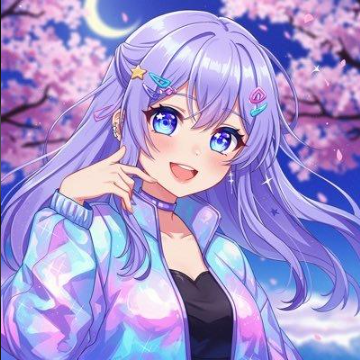
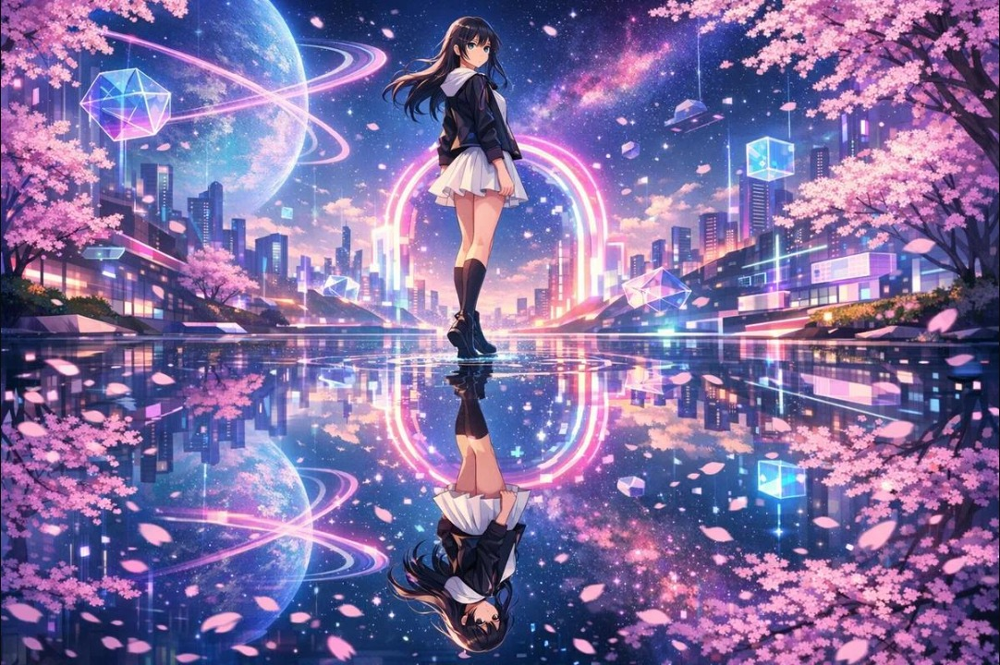

 

 

<h2 align="center">🌸 About Me</h2>

  Welcome to my little corner of GitHub!
   
  I love coding, building projects and exploring new technologies.
   
  Always learning. Always creating. ✨

---

<h2 align="center">🌙 Khushi's Anime World</h2>

  <i>A little universe filled with dreams, stars and cherry blossoms. 💜</i>

&nbsp;&nbsp;

  🌸 Dream • Create • Code • Repeat 🌸

---

<h2 align="center">💜 Tech Stack</h2>

  

---

<h2 align="center">🚀 Featured Project</h2>

<h3>✨ TEAMFLOW</h3>

  A full-stack MERN application with real-time chat and task management.

---

<h2 align="center">📊 GitHub Analytics</h2>

  
  

  

---

<h2 align="center">🏆 GitHub Trophies</h2>

  

---

<h2 align="center">🐍 My Contribution Snake</h2>

  <i>Every contribution is another step in my coding journey!</i>

---

<h2 align="center">🌙 Connect With Me</h2>

  

  <i>"Dream in pixels, build with passion." 💜</i>

  

